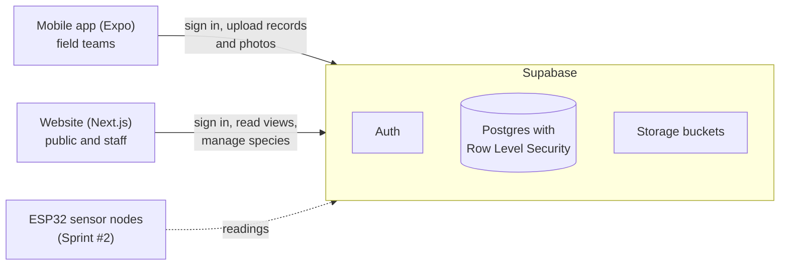
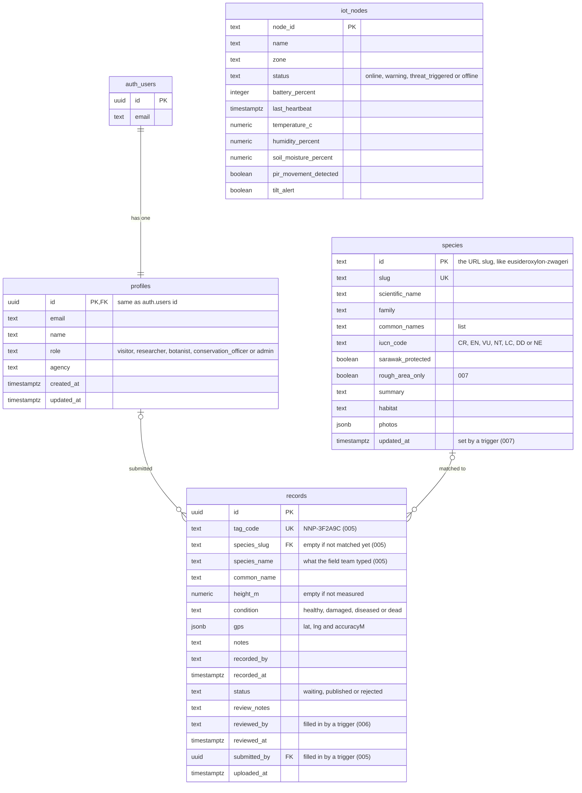

# Database design (item 1)

This is how the data for the Smart Ground-Truthing and Digital Biodiversity System is laid out in
Supabase. It goes with the three high-level design diagrams in this folder:

- [Digital Plant Knowledge System][knowledge], the website and the species data
- [Ground-Truthing Platform][ground], the mobile app that records plants in the field
- [IoT Plant Protection][iot], the ESP32 sensor nodes (Sprint #2 onwards)

[knowledge]: Digital%20Plant%20Knowledge%20System%20-%20High-level%20design.png
[ground]: Ground-Truthing%20Platform%20-%20High-level%20design.png
[iot]: IoT%20Plant%20Protection%20-%20High-level%20design.png

The SQL that builds all of this is in [`supabase/`](../../supabase/README.md), run in order from
001 to 007. Everything below is what those files make, so if they change, this page changes too.

## How the parts talk to each other

- The phone saves records on the device first, so field teams can work without a signal
  (item 9). [sync-design.md](../sync-design.md) has how they upload.
- The website reads through views (below), and staff pages only work for conservation officers
  and admins (items 4 and 15).
- Nothing talks to the database with the service role key. Both apps only use the publishable
  (anon) key plus the person's sign in, so Row Level Security decides what each person gets.

## Tables

The diagram leaves out a few columns the apps don't use yet. The SQL files have all of them.

| Table | What it holds | Who can change it (our SQL) |
| --- | --- | --- |
| `profiles` | One row per account, with its role | Nobody changes their own role. Only an admin changes other people's |
| `species` | The plant knowledge base: names, family, IUCN status, Sarawak protection, text for the public pages | Conservation officers and admins |
| `records` | One row per tagged plant from the field, with its GPS point, condition and review status | Field teams add their own as waiting. Officers and admins review |
| `iot_nodes` | The latest state of each sensor node | Admins. The readings history comes with items 28 and 29 |

Photos aren't stored in the tables. `record-photos` (005) is a private bucket for the photos the
phone uploads with a record. `botanical-photos` (001) is public, because the plant pages show its
species photos, and only officers and admins can add, replace or delete one (006).

## Views

Apps read records through views, so the exact spot of a sensitive plant never goes out to someone
who shouldn't see it.

| View | Who reads it | What it gives |
| --- | --- | --- |
| `species_public` | Anyone, signed in or not | Species for the public pages |
| `records_public` | Anyone, signed in or not | Published records only. The exact spot only for a species that is LC or NT, not protected in Sarawak and not set to rough area only. Everyone else gets the middle of a 0.004 degree grid square (about 440 m at Niah) |
| `species_staff` | Conservation officers and admins | Every species column, for the dashboard forms |
| `records_staff` | Conservation officers and admins | Every record with its exact point, for review and reports |

The website uses the same rule as `records_public` in `showsExactSpot()`
(`web/src/lib/iucn.ts`), so a hidden plant is never drawn as an exact dot.

## Why it's laid out like this

- **The species id is its slug.** The plant page URL, the records and the mobile app all use the
  same id, like `eusideroxylon-zwageri`, so it never changes once a species is added.
- **A record can exist without a species.** A field team might not know what a plant is yet. They
  type a name, `species_slug` stays empty and an officer matches it later. Deleting a species
  leaves its records in place with the slug emptied (005).
- **The tag code is unique.** It's printed on the tree tag and in its QR code, so two records can
  never share one (005).
- **The server fills in who and when.** Triggers set `submitted_by`, `uploaded_at`, `reviewed_by`
  and `reviewed_at`, so a phone or a browser can't send someone else's name (005 and 006).
- **GPS is one JSON column.** The phone sends lat, lng and accuracy together, and a check makes
  sure they're numbers inside sensible ranges (005).
- **Roles live in `profiles`, not in sign up data.** A new account is always a visitor, whatever
  the sign up form sent, and only an admin can make someone a botanist, officer or admin.

## What's planned

- `recorded_by` and `reviewed_by` are text for now. Linking them to `profiles` would make reports
  easier, but the phone's offline records would need a migration first.
- A readings table for the sensors, so we keep history instead of only the latest values
  (items 28 and 29, Sprint #2).
- A photos table if one record ends up with lots of photos (item 18, Sprint #2).

All the sample data is made up. The coordinates sit around park HQ, and the real location of a
threatened or protected plant never goes into this repo.
