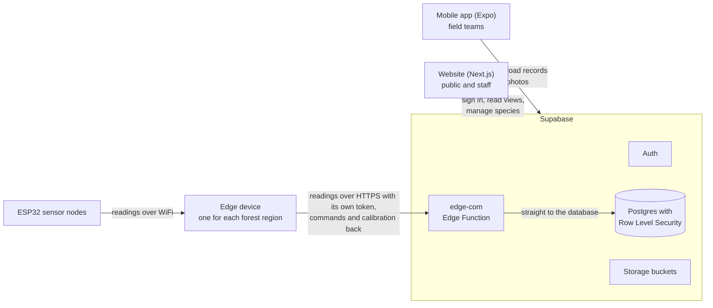
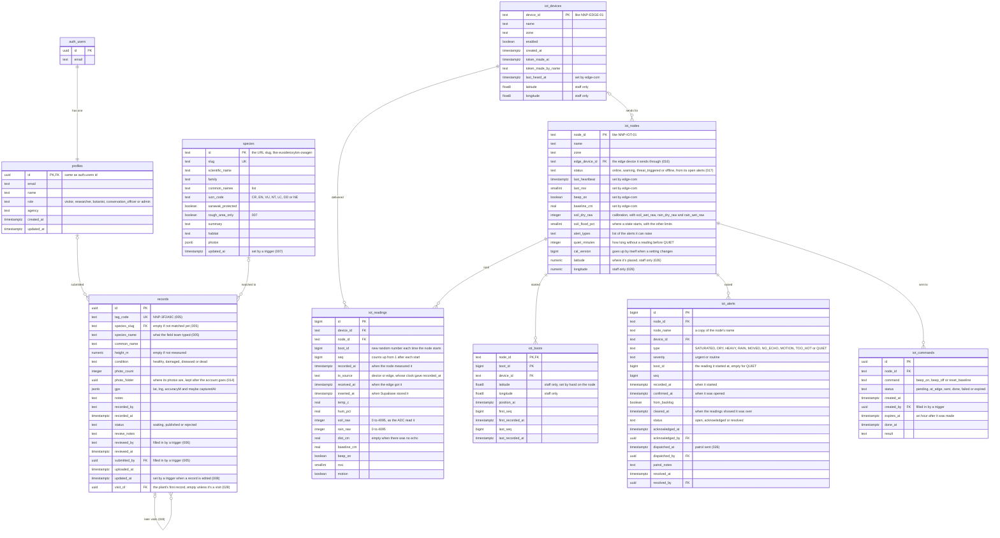

# Database design (item 1)

This is how the data for the Smart Ground-Truthing and Digital Biodiversity System is laid out in
Supabase. It goes with the three high-level design diagrams in this folder:

- [Digital Plant Knowledge System][knowledge], the website and the species data
- [Ground-Truthing Platform][ground], the mobile app that records plants in the field
- [IoT Plant Protection][iot], the ESP32 sensor nodes and edge devices (Sprint #2 onwards)

[knowledge]: Digital%20Plant%20Knowledge%20System%20-%20High-level%20design.png
[ground]: Ground-Truthing%20Platform%20-%20High-level%20design.png
[iot]: IoT%20Plant%20Protection%20-%20High-level%20design.png

The SQL that builds all of this is in [`supabase/`](../../supabase/README.md), run in order from 001
to 028. There's no 018 file, because the phone's photos didn't need one. Everything below is what
those files make, so if they change, this page changes too.

## How the parts talk to each other

- The phone saves records on the device first, so field teams can work without a signal
  (item 9). [sync-design.md](../sync-design.md) has how they upload.
- The website reads through views (below), and staff pages only work for conservation officers
  and admins (items 4 and 15).
- Sensor nodes only talk to the edge device for their region, and only the edge device talks to
  Supabase, through the `edge-com` Edge Function (items 28 and 29).
  [`iot/README.md`](../../iot/README.md) has how.
- Nothing reads or changes a table with the service role key. Both apps use the publishable (anon)
  key plus the person's sign in, so Row Level Security decides what each person gets. The website's
  server only uses the service role key for Supabase Auth: inviting, deactivating and listing
  accounts for an administrator (item 2).
- `edge-com` works differently. It runs inside Supabase and connects straight to the database, so
  Row Level Security doesn't apply to it. It checks each edge device's token itself and only takes
  readings for the nodes an admin has linked to that device. It's the only thing that adds
  readings and node power-ups, opens and ends alerts from readings, and moves a command along.
  [api-reference.md](../api-reference.md) has its request and reply.

## Tables

The diagram leaves out some columns, like most of each node's alert settings and the names kept
next to each staff ID. It also leaves out the small `iot_device_tokens` and `iot_alert_state`
tables, and the tables that only keep a log: `role_changes`, `record_history`, `species_history`,
`deleted_records` and `exact_location_downloads`. The SQL files have all of them.

| Table | What it holds | Who can change it (our SQL) |
| --- | --- | --- |
| `profiles` | One row per account, with its role | Nobody changes their own role. Only an admin changes other people's, and the last admin can't be removed (021) |
| `role_changes` | One line for every role change, with who made it, when, and a copy of the person's email and name (021). Admins can read it | Nobody through the API, admins included. A trigger on `profiles` adds each line |
| `species` | The plant knowledge base: names, family, IUCN status, Sarawak protection, text for the public pages | Conservation officers and admins |
| `species_history` | One line for every change to a species: who saved it, when, and each changed column before and after (013). The species edit page shows it. Officers and admins can read it | Nobody through the API. A trigger on `species` adds each line, and the lines go when the species is deleted |
| `records` | One row per tagged plant from the field, with its GPS point, condition, photos and review status. A later visit to the same plant is a new row whose `visit_of` is the plant's first record, so the first record stays as it was. It's one level: a visit always points at the first record, never at another visit, and a trigger checks that. Deleting the first record keeps its visits as records on their own (028) | Field teams add their own as waiting. Officers and admins review, edit and delete any record |
| `record_history` | The same for records (013), shown on the record edit page. Where a plant is never goes in here, only whether it had a spot before and after. Officers and admins can read it | Nobody through the API. A trigger on `records` adds each line, and the lines go when the record is deleted |
| `deleted_records` | The ID of every deleted record, with who deleted it and when, and nothing else about the plant (010). A phone can't upload a record with one of these IDs again. Officers and admins can read it | Nobody through the API. A trigger adds the ID when a record is deleted |
| `exact_location_downloads` | One line for every reports CSV downloaded with exact spots: who, when, the filters and how many exact spots it had, but no coordinates (011). Admins can read it | Officers and admins add their own line, which the website does before it sends the file. Nobody changes or removes one |
| `iot_nodes` | Each sensor node, the edge device it sends through, its calibration and alert settings, and where it's placed (026). `status` comes from its open alerts, and `last_heartbeat`, `last_rssi`, `beep_on` and `baseline_cm` from its latest reading | Admins. `edge-com` keeps the status and latest reading columns up to date, and `cal_version` goes up by itself when a calibration or alert setting changes |
| `iot_devices` | Each edge device, whether it's turned on, when it was last heard from and where it is | Admins |
| `iot_device_tokens` | A hash of each edge device's token, never the token itself | Nobody through the API, admins included. An admin makes a new one with `iot_make_device_token`, which hands the plain token back once |
| `iot_readings` | Every reading from every node, with the raw values as the node measured them (016_4). Soil and rain percent aren't stored, because `iot_raw_pct` works them out from the node's calibration when they're read | Only `edge-com` adds them, for the nodes linked to the device that sent them, and at most 3,600 an hour for each device (022). Nobody changes or removes one |
| `iot_boots` | One row each time a node starts: where it's installed (set by hand on the node, which has no GPS) and its first and last reading, so you can see whether readings went missing (023) | Only `edge-com` |
| `iot_alerts` | One row for each problem on a node, from when it started to when the readings show it's over, with who acknowledged it, sent a patrol and resolved it. Urgent could mean someone at the plant, a fire or a flash flood. Routine ones (DRY, RAIN) can wait for the next patrol | `edge-com` opens and ends them, and `iot_raise_quiet_alerts` adds QUIET ones (017). Officers and admins only change them with `iot_acknowledge_alert`, `iot_dispatch_patrol` (026) and `iot_resolve_alert` |
| `iot_alert_state` | `edge-com`'s working state for each node and alert type: how many readings in a row show it or are back to normal, which alert is open, and when the last one ended (024) | Only `edge-com`. Nobody can read or change it through the API |
| `iot_commands` | Commands for a node: the locate beep on or off, or taking its distance now as normal. Each one goes from pending to at_edge, sent, then done or failed, or expired after an hour (025) | Officers and admins add one with just a node and a command, and the database fills in who and when. After that only `edge-com` changes it |

Photos aren't stored in the tables. `record-photos` (005) is a private bucket for the photos the
phone uploads with a record. Field staff reach their own while they hold that role, and officers
and admins reach all of them (020). `botanical-photos` (001) is public, because the plant pages
show its species photos, and only officers and admins can add, replace or delete one (006).

## Views

Apps read records through views, so the exact spot of a sensitive plant never goes out to someone
who shouldn't see it.

| View | Who reads it | What it gives |
| --- | --- | --- |
| `species_public` | Anyone, signed in or not | Species for the public pages, without coordinates or photos |
| `species_photos_public` | Anyone, signed in or not | Each species' photos, for the plant pages (009). They're public anyway, since the bucket is |
| `records_public` | Anyone, signed in or not | Published records only, with no notes and no names of who recorded or reviewed them. The exact spot only for a species that is LC or NT, not protected in Sarawak and not set to rough area only, on a record whose name matches that species. Everyone else gets the middle of a 0.004 degree grid square (about 440 m at Niah) and the day it was recorded, not the time (019). A visit only shows its exact spot when its first record would too (028) |
| `record_visits_public` | Anyone, signed in or not | The ID of each visit and its first record, only when both are published (028). The public tag page uses it to list a plant's visits |
| `species_staff` | Conservation officers and admins | Every species column, for the dashboard forms |
| `records_staff` | Conservation officers and admins | Every record with its exact point, for review and reports, and `visit_of` for visits (028) |
| `iot_node_status` | Conservation officers and admins | Each node's latest reading, its soil and rain percent, the state of each sensor, how many alerts are still going on, whether it's gone quiet and where it's placed (026). The Sensors and Ecology pages and the dashboard map use it |
| `iot_daily_summary` | Conservation officers and admins | Each node's day in figures for today and the 6 days before, in park time: how many readings, and the lowest, average and highest temperature, humidity and soil moisture (027). The Sensors page shows them on each node's card |

The two IoT views read as whoever is asking, so the Row Level Security on the IoT tables decides
who gets rows. Nobody else, and nothing public, can read them.

The website uses the same rule as `records_public` in `showsExactSpot()`
(`web/src/lib/iucn.ts`) and `recordHidesLocation()` (`web/src/data/species.ts`, which also checks
the name), so a hidden plant is never drawn as an exact dot.

## Why it's laid out like this

- **The species id is its slug.** The plant page URL, the records and the mobile app all use the
  same id, like `eusideroxylon-zwageri`, so it never changes once a species is added.
- **A record can exist without a species.** A field team might not know what a plant is yet. They
  type a name, `species_slug` stays empty and an officer matches it later. Deleting a species
  leaves its records in place with the slug emptied (005).
- **The tag code is unique.** It's printed on the tree tag and in its QR code, so two records can
  never share one (005).
- **The server fills in who and when.** Triggers set `submitted_by`, `uploaded_at`, `reviewed_by`
  and `reviewed_at`, so a phone or a browser can't send someone else's name (005 and 006).
- **GPS is one JSON column.** The phone sends lat, lng, accuracy and the time of the GPS reading
  together, and a check makes sure they're inside sensible ranges (005).
- **Roles live in `profiles`, not in sign up data.** A new account is always a visitor, whatever
  the sign up form sent, and only an admin can make someone a botanist, officer or admin.
- **A device token is only kept as a hash.** Each edge device has its own, and it can only add
  readings for that device's nodes, so a copy of the table doesn't give anyone a working token (016).
- **Readings keep the raw values.** Soil and rain percent are worked out when they're read, with
  each node's calibration in `iot_nodes`, so a recalibration fixes the old readings too (016_4).
  A node numbers its readings from 1 each time it starts, and that number plus the start's
  `boot_id` is unique, so a reading the edge sends twice is only stored once.
- **Alerts are decided in `edge-com`, not by a trigger.** When an upload arrives, `edge-com` checks
  each reading against the node's settings in `iot_nodes`, and keeps its count of readings in a row
  in `iot_alert_state` (024). So a node can need a few readings before an alert opens or ends, and
  one ongoing problem is one alert (017). This happens whether the website is open or not.
- **QUIET has its own check.** No reading arrives to set it off, so `iot_raise_quiet_alerts` looks
  for quiet nodes after every upload from any edge and each time a staff page loads. That way it
  still works when a region's edge is down (017).
- **Node coordinates stay with staff.** Nodes sit beside protected plants, so the positions in
  `iot_nodes`, `iot_devices` and `iot_boots` are only for officers and admins, and no public view
  reads any IoT table (016, 017, 023 and 026).

## What's planned

- `recorded_by` and `reviewed_by` are text for now. Linking them to `profiles` would make reports
  easier, but the phone's offline records would need a migration first.
- A photos table if one record ends up with lots of photos (item 18, Sprint #2).

All the sample data is made up. The coordinates sit around park HQ, and the real location of a
threatened or protected plant never goes into this repo.
