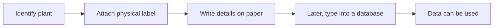
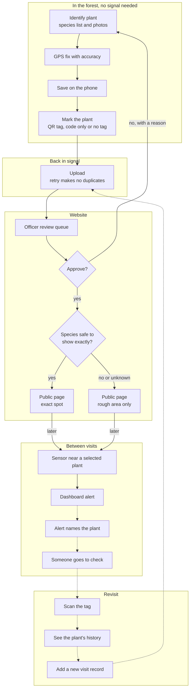

# Proposed innovative workflow

Item 39. This is our proposed way of doing ground-truthing at Niah. Each change traces back to a
limitation (L1 to L12) from [the analysis](ground-truthing-limitations.md).

**Status: this is a design.** Some steps are built and tested on simulators, a browser and a local
stand-in database. Some are being built (items 10, 11, 12 and 28 to 31). Some are new work for item
40. We have no field results, and every target below is not yet measured in the field.

## Current and proposed, step by step

The current column comes from the Project Scope. We haven't watched a survey, so where the Scope is
silent, we say so.

| # | Step | Current | Proposed | Answers | Status |
| --- | --- | --- | --- | --- | --- |
| 1 | Prepare | The Scope doesn't describe this | Sign in and get the latest species list while there's still signal | L6 | Being built (item 10) |
| 2 | Identify | Plant gets identified. The Scope doesn't say how | Pick from the species list with suggestions and take photos. A name not on the list is allowed, and stays hidden from the public by default | L3, L7, L9 | Form built (item 7), photos being built (item 11) |
| 3 | Record | Written on paper | Saved on the phone, no signal needed | L2, L3, L6 | Built (item 9), simulator and browser only |
| 4 | Location | The Scope doesn't say how | GPS with accuracy saved. A record can't be saved without it | L1 | Built (item 8), iOS simulator only |
| 5 | Mark the plant | Physical label | QR tag tied to the record's ID. Protected plants get a code only tag or no tag, SFC decides | L4, L10 | Scanner built (item 6), printing being built (item 12), tag choice is new work |
| 6 | Get the data in | Typed into a database later | Phone uploads when it has signal. Retrying can't create a duplicate | L3, L5, L6 | Server built (item 3), phone being built (item 10) |
| 7 | Check | The Scope doesn't describe this | Officer approves, or rejects with a reason that goes back to the phone | L7, L8 | Built (item 19), stand-in only. Reason reaching the phone needs item 10 |
| 8 | Publish | The Scope says access to up to date information is limited | Only approved records go public. Threatened, protected and unknown plants get a rough area automatically | L5, L9 | Built, stand-in only |
| 9 | Between visits | The Scope doesn't describe this | Sensors near selected plants. An alert names the plant and someone goes to check | L11 | Dashboards being built (items 28 to 31). Link to a plant and notification are new work |
| 10 | Revisit | The Scope doesn't describe this | Scan the tag, see the plant's history with no signal, add a new visit record instead of overwriting | L4, L8, L11 | Scan built. History and visit records are new work |

### Current workflow

### Proposed workflow

Read it from the top. Dashed arrows are new work for item 40. Solid arrows are built or being built,
apart from "later", which just marks time passing.

## A gap we found: printing tags

The phone makes the tag code when a record is saved, but printing is a later step (item 12), and
nobody can print in the forest. So there's a real order problem in our own design.

| Option | Good | Bad |
| --- | --- | --- |
| Go back later and attach the tag | No new code | A second trip, and a chance of tagging the wrong plant |
| Pre-print tags, and the phone takes its ID from the tag scanned at registration | Tag goes on during the same visit. Clashes get checked before printing | New work, because the tag code is generated from the record's ID today. Someone has to manage the batches |
| Carry a portable printer | Tag made on the spot | Weight, battery, weather and cost. We have no data on any of them |

We'd try pre-printed tags first, but it needs deciding in item 12 or item 40. Without one of these,
step 5 doesn't work as drawn.

## How each change traces back

| Limitation | What changes | What's left |
| --- | --- | --- |
| L1 Unknown accuracy | Accuracy is required and stored, and the officer sees it | Doesn't make a poor fix better. Untested under canopy |
| L2 Paper lost | Saved to the phone straight away | Phone loss before upload. Encryption (item 22) not merged |
| L3 Double handling | Typed once, with checks, and no duplicates on retry | Phone can't edit after upload |
| L4 Tags not tied to a record | Tag code comes from the record's ID, and a scan opens it offline | Scan only finds records on that phone. Tag life unknown |
| L5 Long gap | Upload on signal, then the website | The wait may move to the review queue |
| L6 No signal | Everything in the forest works offline | Sign in and species list updates depend on item 10 |
| L7 Wrong names | Review before public, with checks shown | Officer sees a photo, not the plant |
| L8 No trail | Who and when stamps, edit history, and visits added rather than overwritten | Trail doesn't prove someone was right |
| L9 Locations leak | Automatic rough area, hidden unless known safe | Wrong name can still show an exact spot. SFC sets the size |
| L10 Tags mark the plant | Code only tag or no tag for protected plants | SFC's choice. Without a tag, a revisit relies on GPS and notes |
| L11 Nothing between visits | Alert sends someone to a named plant | Not built. False alarms and radio range are open |
| L12 Labour and cost | No typing up, if the trial supports that. Sensors only on selected plants | No cost data. Upkeep not planned |

## What's actually innovative

No single part of this is new. ODK Collect already works offline with barcodes, location and images
(ODK, n.d.-b). ODK Central has approve and reject, and its Entities can link repeat visits to a
lasting record like a tree (ODK, n.d.-a). Survey123 can find a record by scanning a barcode (Esri,
n.d.). KoboToolbox has approved and not approved states (KoboToolbox, 2026). iNaturalist hides
sensitive species automatically (iNaturalist, n.d.).

So our Solution Direction goes too far where it says those tools can't do this. The fairer reason is
that they'd be a separate platform we'd export from. The pages we read also don't describe publishing
to a public site with automatic rough areas after approval.

What we think goes beyond doing the same thing digitally is how the parts join up:

1. **A QR tag ties the plant to its record with no signal.** The code comes from the record's own ID,
   so a scan in the forest opens the local record. The same tag gives a visitor a public page.
2. **Approval comes before public.** Typing paper into a database moves data around. Here, a named
   person has to accept a record before anyone outside can see it.
3. **Rough areas are automatic and hidden by default.** Nobody has to remember to hide a plant. Unknown
   names get hidden, and it's worked out when the data is read, so a species newly marked as protected
   is hidden on its old records too.
4. **A sensor alert sends someone to a specific plant, and the visit becomes evidence.** It goes from
   alert to named plant to scan to a new record, between surveys. We haven't found a plant version of
   this in the sources we read, which doesn't mean there isn't one. Kamminga et al. (2018) is about
   animals. This is also the least built part.

None of this makes someone better at identifying a plant. It also doesn't solve the problem that no
reviewed detection system has both high detection and low response time (Kamminga et al., 2018).

## Risks and what would make it fail

| It fails if | Why that could happen | What we'd do |
| --- | --- | --- |
| A tag gives away a protected plant | A scan names the species at that spot, whatever the map hides. RAINFOR warns about markers that attract attention (Phillips et al., 2018, p. 5) | Code only tag or no tag. If SFC refuses tags on these plants, they rely on GPS and notes |
| A wrong name shows an exact spot | Goodwin et al. (2015) show how common wrong names are | Officer check, and SFC's list of hidden species. A name not matched to our species list stays hidden |
| Officers can't keep up | Approve needs a person, and we don't know how much time they have | Measure the wait. A long queue brings the old delay back |
| Alerts are mostly false | Wind and rain cause false triggers (Kamminga et al., 2018) | Count false alarms. If people stop trusting alerts, drop this step and keep the rest |
| Phones do worse than paper in the rain | Waterproof paper still works (Phillips et al., 2018, p. 15), and we haven't tested phones in rain | Keep paper as a backup, compare both in the trial |
| GPS is too poor near cliffs | Never tested there, and forest canopy already hurts accuracy (Purfürst, 2022) | Show the accuracy, add notes on how to find the plant |
| Tags don't last | Tags get lost (Phillips et al., 2018, p. 15), and our wet and dirty tag tests haven't been done | Typed code and GPS as a fallback. Test tags outdoors |
| Sensor radio doesn't reach | Range drops in woods (Bianco & Marrocco, 2022), and canopy is the hard part (Ansah et al., 2020) | The prototype uses cable and WiFi, so LoRa needs its own test |
| Batteries and upkeep cost too much | Sensors left out need upkeep (Kamminga et al., 2018), and we have no costs | Selected plants only. Get costs before item 40 grows |
| Staff don't adopt it | We haven't tested with SFC staff, and tablets didn't save time in King et al. (2013) | Usability test, then ask SFC |
| Supabase or Vercel goes down or changes | The website and upload depend on them | Phones keep saving offline. Agree an owner at handover |
| The current workflow isn't what we think | It comes only from the Scope | Ask SFC. If it's wrong, our comparison is too |

## Evaluation plan

We'd run this for item 41. **Every row is not yet measured in the field.** A trial must not use real
endangered plants or real coordinates. It uses test tags, common plants and marked reference points on
campus, with made up species marked as endangered to test hiding. Item 41 can only reach Niah if SFC
gives us a visit.

| Measure | Target (from the proposal) | How we'd measure it | Status |
| --- | --- | --- | --- |
| Saving a record offline | Under 1 s | Time from Save to confirmation in flight mode, on real Android and iOS phones | Not yet measured in the field |
| Submitting a record on 4G | Under 3 s | Time one upload on real 4G, photos measured separately | Not yet measured in the field |
| Synced records with GPS and accuracy | 100% | Count them in the test database after the trial | Not yet measured in the field |
| Public pages or API responses showing exact coordinates of an endangered species | 0 | Script checks every public page and API response for the made up exact points, logged out | Not yet measured in the field. Only the rule has been tested, on the local stand-in |
| GPS on open ground | 90% within 10 m of a reference point | Compare readings with marked points. Also record shade, with no target | Not yet measured in the field |
| QR scans | 95% within 3 s in sun and shade, and a no signal scan opens the saved record | Time a set of printed tags, including wet and dirty ones | Not yet measured in the field |
| Required fields correct | 95% | Compare records with a known answer sheet | Not yet measured in the field |
| Sync | 0% data loss, within 5 minutes of signal, no duplicates after a failed sync | Cut the connection during upload, then count records | Not yet measured in the field |
| Usability | 90% task completion, SUS 70 or above | Task test and SUS form. SFC staff if they're willing, otherwise students | Not yet measured in the field |
| Alerts | Within 30 s, under 5% missing readings over 24 h | Trigger a sensor and time it, and run a node for 24 h | Not yet measured in the field |

The proposal's targets don't cover everything the Scope asks about, so we'd also record these, with no
target and no number claimed yet:

- **Paper against phone.** The same people record the same set of plants both ways, half starting with
  paper and half with the phone. We'd count time per record, including typing up paper afterwards, and
  errors against an answer sheet.
- **Wait in the review queue.** Time from upload to decision.
- **False alarms.** The share of alerts with no real event behind them, including outdoors in wind and
  rain.
- **Alert to arrival.** Time from an alert to someone scanning the right test tag.

Here's how this maps to what the Scope wants us to show. These are hypotheses until the trial runs:

- **Efficiency:** total time per record falls once typing up is counted. Field time alone might not
  change (King et al., 2013).
- **Accuracy:** fewer wrong or missing fields, and every location has a known accuracy.
- **Scalability:** more records and people don't mean more typing. Limits are tag code clashes after a
  few thousand records, one queue that depends on officer time, and sensors that can't cover every
  plant.

**What the trial can't show.** Campus isn't Niah, with no karst and much less canopy. Students aren't
botanists. A short trial can't show how long tags or batteries last, or whether any of this reduces
theft. Numbers from a small group are only a first look. Real claims would need a pilot with SFC.

**If a target fails, we report it.** We'd give the number and what we think it means. If phones aren't
faster than paper, the case rests on accuracy and lost records instead, and we'd say so.

## Assumptions to test

These are our assumptions, not findings.

| Assumption | How we'd test it |
| --- | --- |
| Most survey areas have little or no signal | Ask SFC, and log signal on a visit if we get one |
| The Scope's workflow matches what staff do | Ask SFC to walk us through a survey and show a real blank sheet |
| QR tags stay readable in a wet forest | Leave test tags outside on campus and scan them weekly. That only shows weeks, not years |
| Officers have time to review | Ask SFC, and time reviews in the trial |
| Sensors can tell real events from wind, rain and animals | Log false triggers outdoors over time |
| Staff will carry and charge a phone instead of paper | Usability test, then ask SFC |

## What item 40 needs

- A link from a sensor node to plant records. It's officers and admins only, because it says where the
  plant is.
- A way to tell field staff about an alert, and a decision on who responds. We have no ranger role.
- Revisit records, plus the plant's history on the phone, so a second phone can find the record too.
- SFC's decision on tags for protected plants, and how big the rough area should be.
- The pre-printed tag decision, with item 12.

## References

**Project documents (not published):** Project Scope, the team's proposal, Solution Direction, and
Stakeholders and Quality Management. The targets appear in both the proposal and Stakeholders and
Quality Management. Our team reports don't set a citation style, so we use APA here.

Ansah, M. R., Sowah, R. A., Melià-Seguí, J., Katsriku, F. A., Vilajosana, X., & Banahene, W. O. (2020).
Characterising foliage influence on LoRaWAN pathloss in a tropical vegetative environment. *IET
Wireless Sensor Systems, 10*(5). https://doi.org/10.1049/iet-wss.2019.0201

Bianco, G. M., & Marrocco, G. (2022). *Indirect propagation of body-UAV LoRa links over wood and
suburb* [Conference paper]. 3rd URSI AT-AP-RASC, Gran Canaria.
https://www.ursi.org/proceedings/procAT22/ATAPRASC2022-papers/MDG0A59MQB.pdf

Esri. (n.d.). *Edit existing survey data*. ArcGIS Survey123 documentation.
https://doc.arcgis.com/en/survey123/capture/field-app/editexistingdata.htm

Goodwin, Z. A., Harris, D. J., Filer, D., Wood, J. R. I., & Scotland, R. W. (2015). Widespread mistaken
identity in tropical plant collections. *Current Biology, 25*(22), R1066-R1067.
https://doi.org/10.1016/j.cub.2015.10.002

iNaturalist. (n.d.). *How does iNaturalist protect the locations of sensitive species?*
https://help.inaturalist.org/en/support/solutions/articles/151000233080-how-does-inaturalist-protect-the-locations-of-sensitive-species-

Kamminga, J., Ayele, E., Meratnia, N., & Havinga, P. (2018). Poaching detection technologies: A survey.
*Sensors, 18*(5), 1474. https://doi.org/10.3390/s18051474

King, J. D., Buolamwini, J., Cromwell, E. A., Panfel, A., Teferi, T., Zerihun, M., Melak, B., Watson, J.,
Tadesse, Z., Vienneau, D., Ngondi, J., Utzinger, J., Odermatt, P., & Emerson, P. M. (2013). A novel
electronic data collection system for large-scale surveys of neglected tropical diseases. *PLoS ONE,
8*(9), e74570. https://doi.org/10.1371/journal.pone.0074570

KoboToolbox. (2026). *Viewing and validating your data*.
https://support.kobotoolbox.org/viewing_validating_data.html

ODK. (n.d.-a). *ODK Central*. https://docs.getodk.org/central-intro/

ODK. (n.d.-b). *ODK Collect*. https://docs.getodk.org/collect-intro/

Phillips, O., Baker, T., Feldpausch, T., & Brienen, R. (2018). *RAINFOR field manual for plot
establishment and remeasurement* (2018.1 ed.).
https://forestplots.net/upload/publication-store/itm_141/RAINFOR_field_manual_EN.pdf

Purfürst, T. (2022). Evaluation of static autonomous GNSS positioning accuracy using single-, dual-, and
tri-frequency smartphones in forest canopy environments. *Sensors, 22*(3), 1289.
https://doi.org/10.3390/s22031289
