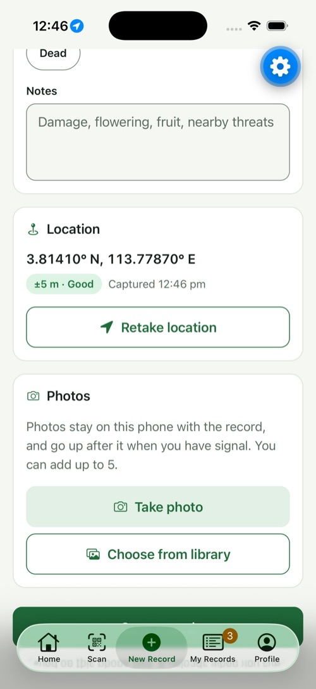
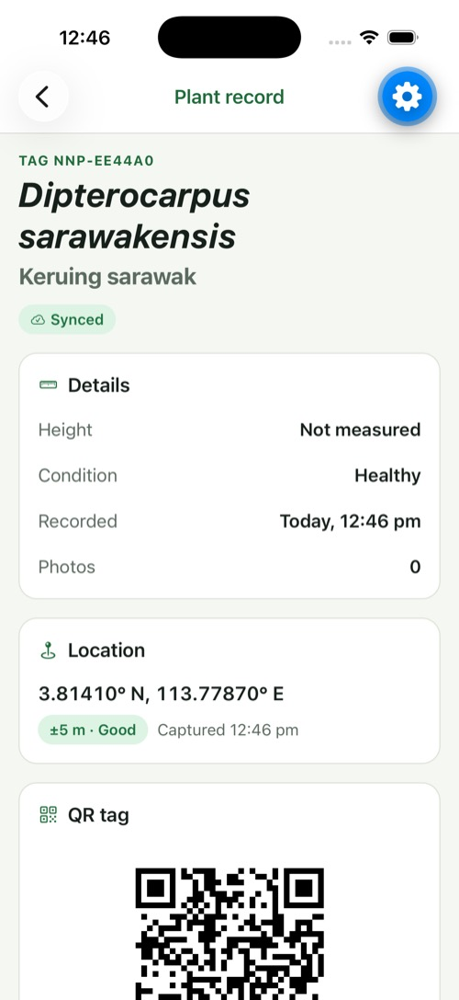
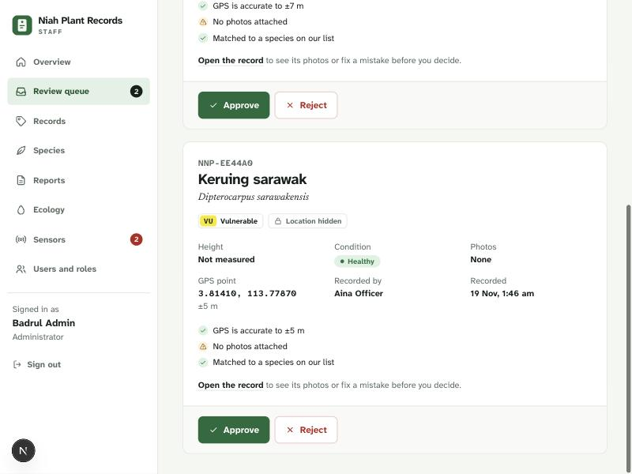
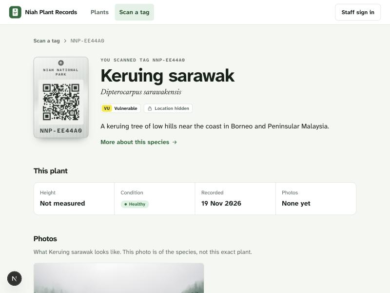
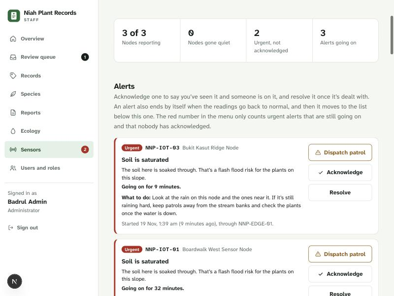

# Item 43 test results: final system integration testing

This ran on 18 Nov 2026 on Umer's Mac on `main`. The earlier items each tested one part. This one
follows a plant record and a sensor alert all the way through the system, from where they start to
where a person sees them. The hosted Supabase project is behind on the SQL files
(`supabase/README.md`), so everything ran against the Supabase stand-in in `supabase/tests/stand-in.js`
instead.

## What ran

| Part | How it ran |
| --- | --- |
| Database and API | The stand-in on port 54321, with SQL 001 to 027 and the `edge-com` function |
| Website | `next dev` on port 3210 against the stand-in (the `web-stand-in` launch setting) |
| Phone app | Expo Go 57.0.9 on the iPhone 17 Pro simulator (iOS 26.5), against the stand-in (`mobile-stand-in`) |
| Edge device | `thing-com.py` and `cloud-com.py` from `iot/edge-device` on Python 3.12, with Mosquitto 2.1.4 on port 1884 |
| Sensor node | `tools/fake-thing.py` acting as node NNP-IOT-03, since there is no ESP32 here |

## Path 1: a ranger's record to the public site

| Step | What happened | Result |
| --- | --- | --- |
| 1. Sign in on the phone | Signed in as the stand-in's officer account (Aina Officer) | Pass |
| 2. Start a record | New record, typed "Diptero" and picked *Dipterocarpus sarawakensis* from the list. The common name filled itself in as Keruing sarawak | Pass |
| 3. Capture location | The simulator's location was set to park HQ (3.8141, 113.7787). Capture gave 3.81410° N, 113.77870° E, ±5 m, marked Good | Pass |
| 4. Save and sync | Saved as tag NNP-EE44A0 and showed as Synced straight away. The stand-in logged `POST /rest/v1/records 201` | Pass |
| 5. Review on the website | Signed in as the admin account. The review queue showed the record waiting, with its checks: GPS ±5 m, no photos, matched to a species, Vulnerable, location hidden | Pass |
| 6. Approve | Approve showed "Approved Keruing sarawak, NNP-EE44A0." and the record moved to Recently reviewed under Badrul Admin | Pass |
| 7. Public tag page | Signed out and opened `/tag/NNP-EE44A0`. It answered 200 in 0.66 s (59 kB) and showed the species, Vulnerable, location hidden, Healthy and Recorded 19 Nov 2026. None of the GPS numbers were anywhere in the page's HTML | Pass |

| Location on the phone | Synced record on the phone |
| --- | --- |
|  |  |





Notes from this path:

- **Who approves.** We first tried approving as the botanist account and got "No access", because the
  staff dashboard is only for conservation officers and administrators. That is how item 4 set it up,
  so the record was approved as the admin. If botanists are meant to review on the website, that is a
  change to the roles, not a bug.
- **Two times for one moment.** The phone shows the time on the device, which was 12:46 pm on 18 Nov
  on the Mac. The website shows park time (UTC+8), which was 1:46 am on 19 Nov. They are the same
  moment.
- **No photo.** The simulator's photo picker was too slow to use in this run, so the record was saved
  without one. Photos from the phone to the website are covered by [item 11](item-11-photos.md).

## Path 2: a sensor alert to the dashboard

The edge device ran on the Mac with a copy of `iot/edge-device/config.example.toml` that pointed at a
local database file, used Mosquitto on port 1884 and uploaded every 10 s instead of 60 s. The
secrets file pointed at the stand-in's `edge-com`. Then, from `iot/edge-device`:

```bash
python tools/fake-thing.py --node NNP-IOT-03 --count 8 --interval 5 --flood-at 4
```

This sends 8 readings 5 s apart, and from the 4th one on the soil reads as flooded.

What the edge logs showed (times are on the Mac, so park time is 13 hours ahead):

| Time | What happened |
| --- | --- |
| 12:39:02 | cloud-com's first check with Supabase. It got the calibration for 3 nodes (1,038 bytes down) |
| 12:39:09 | thing-com saw NNP-IOT-03 come online |
| 12:39:13 | First upload: 1 reading and the node's power up position, 185 bytes |
| Readings 1 to 3 | Soil 69%, normal |
| 12:39:25 | Reading 4: soil 99%, saturated. thing-com marked it as a quick alert and cloud-com sent it to Supabase 0.8 s after the reading reached the edge, without waiting for the next upload |
| Readings 5 to 8 | Still saturated, sent with the normal uploads |
| 12:39:45 | thing-com saw the node go offline after the 8th reading |

All 8 readings reached Supabase in 5 uploads (1, 2, 1, 2 and 2 readings). Each upload was 150 to
185 bytes after gzip and took 0.19 to 1.48 s.

On the website, the sensors page (`/dashboard/sensors`, signed in as the admin) showed:

- An **Urgent** alert for NNP-IOT-03, Bukit Kasut Ridge Node, "Soil is saturated", started 19 Nov
  1:39 am through NNP-EDGE-01.
- The node's card said "From 8 readings since midnight" with soil at 97%, Saturated.
- 3 of 3 nodes reporting. The other nodes and alerts on the page were already in the stand-in's
  made up data.



### Against the 30 s target

The test plan asks for alerts within 30 s. Before this, we only had about 25 s from adding up the
steps. Here it was 0.8 s from the reading reaching the edge to it being in Supabase, and the sensors
page checks for new alerts every 15 s, so the alert is on screen within about 16 s at worst. A quick
alert doesn't wait for the upload timer, so the 60 s setting on the real edge doesn't change this.

That leaves out two links that only exist in the park: the node's WiFi to the edge, and the edge's
internet to hosted Supabase. Both need the real hardware.

## What this run doesn't cover

- **Hosted Supabase and Vercel.** The live site can't run this until 003 to 027 are on hosted and
  `edge-com` is deployed (`supabase/README.md`).
- **Real phones.** Only the iOS simulator. No Android phone and no iPhone on iOS 16.4 to 18. Expo SDK
  57 needs iOS 16.4 or newer.
- **Real sensor hardware.** No ESP32 and no edge VM, so no WiFi or LoRa in the path.
- **Rejecting a record.** Covered by [item 19](item-19-observation-approval.md).
- **Photos.** Covered by [item 11](item-11-photos.md).
- **Field validation with rangers.** That is item 41 and needs the park.

## How to run it again

1. Start `supabase-stand-in`, `web-stand-in` and `mobile-stand-in` from the launch settings, and open
   the app in Expo Go on the simulator.
2. Put the simulator at park HQ with `xcrun simctl location booted set 3.8141,113.7787`.
3. Make a record on the phone as `officer@example.test`, then approve it on
   `http://127.0.0.1:3210/dashboard/review` as `admin@example.test`. The password is
   `TEST_PASSWORD` in `stand-in.js`.
4. Open `/tag/<the tag code>` in a private window.
5. For the sensor path, run Mosquitto with a password file, then `thing-com.py` and `cloud-com.py`
   with `IOT_EDGE_CONFIG` pointing at the copied config, then the `fake-thing.py` command above. The
   edge needs Python 3.11 or newer. The secrets come from `secrets.example.toml`, with the stand-in's
   `TEST_DEVICE_ID` and `TEST_DEVICE_TOKEN`. [Item 29](item-29-sensor-pipeline.md) has more on the
   edge setup.
