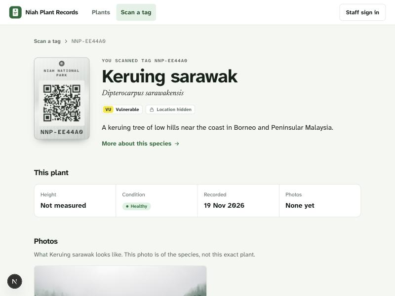
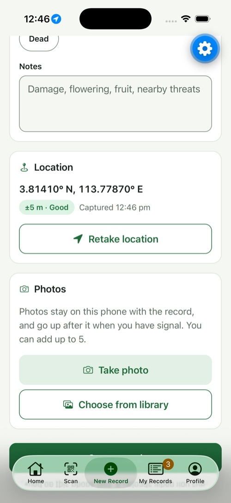
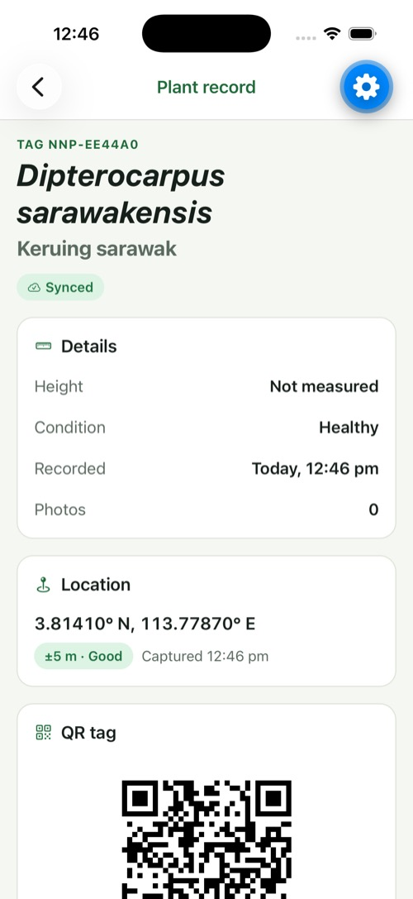
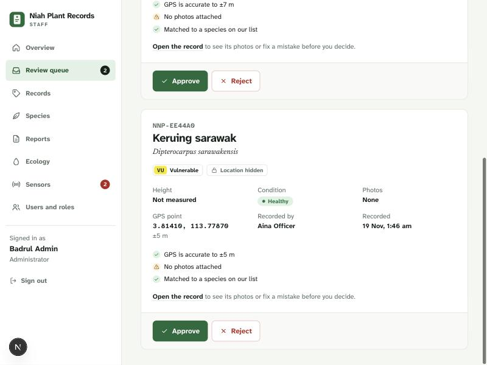
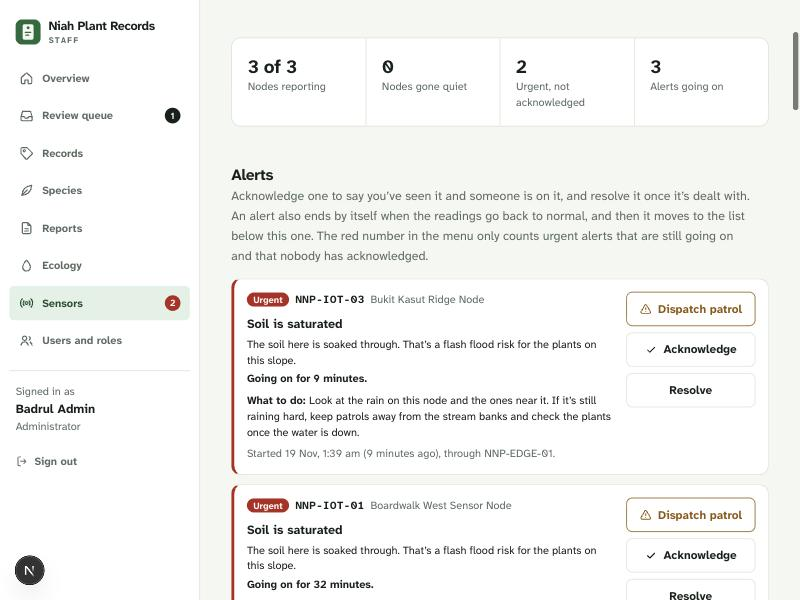

# Niah Plant Records user guide

This guide is for the people who use Niah Plant Records: visitors to Niah National Park, the field
teams who tag plants, and the conservation officers and administrators who check the records. It
covers the public website, the staff pages of the website, and the phone app.

Buttons are written like **Approve** and messages like "Nothing left to review", the same way they
show on screen. It only covers what the system does now.

## Contents

1. [Who does what](#who-does-what)
2. [Visitors](#visitors)
3. [Rangers and officers on the phone](#rangers-and-officers-on-the-phone)
4. [Botanists](#botanists)
5. [Conservation officers on the website](#conservation-officers-on-the-website)
6. [Administrators](#administrators)
7. [When something goes wrong](#when-something-goes-wrong)

## Who does what

Every account has one role. An administrator sets it on **Users and roles**.

| Role | Phone app | Website |
| --- | --- | --- |
| No account | Visitor mode: scan tags and read about plants | The public pages |
| Researcher | Can sign in, but can't upload records | The public pages. The staff pages say **No access** |
| Botanist | Records plants and syncs them | The public pages. The staff pages say **No access** |
| Conservation officer | Records plants and syncs them | The public pages and the staff pages |
| Administrator | Records plants and syncs them | Everything, including who has an account |

There is no "ranger" role. In this guide a ranger is anyone in the field team, and their account
should have the **Botanist** role, because that is the role that can upload records from the phone.
The website calls them "the recorder" or "the person who recorded it", like "Recorder's note" in
the review queue.

**Times.** The website and the phone app show every time in park time (Sarawak, UTC+8), wherever you
open them from, so the same record shows the same time on both.

The screenshots come from the test run in [item 43](test-results/item-43-integration.md), with made
up accounts and records.

## Visitors

You don't need an account. The website works on any phone or computer with a connection. The phone
app in visitor mode also works with no signal.

### Browsing plants

1. Open the website. The home page says "Look up a tagged plant".
2. Type a name in **Search by plant name** and press **Search**, or press **Plants** at the top.
3. On **Plants**, type in **Search plants**. It looks at the common name, the Latin name and the
   family.
4. Press **All**, **Threatened** or **Not threatened** to narrow the list. The line under the search
   says how many match, like "Showing 3 of 12 plants".
5. If nothing matches, the page says "Nothing matches" and what you typed. Press **Clear search** to
   start again.
6. Open a plant to see its species page.

A plant in the list can have these badges:

- its IUCN Red List status
- "Protected in Sarawak"
- "Location hidden", when the map only shows the rough area (see
  [Why some locations are hidden](#why-some-locations-are-hidden))

The species page starts with a "Specimen label" box: Family, Species, Local names, IUCN, Sarawak,
Public map ("Exact point" or "Rough area only"), Tagged and Updated. Below it are About, "Where it
grows", "How people use it" and "Conservation status" when the park has written them. "Tagged in the
park" lists the newest 50 tagged plants of that species, with a map.

### Scanning a QR tag

Every tagged plant has a QR tag with its code under it, like NNP-3F2A9C.

**With your phone's camera app:** point it at the QR tag. It opens the plant's page on the website.

Some tags hold only the code, so the camera app shows the code as text and doesn't open a page.
These are on protected and threatened plants, so a photo of the tag can't lead anyone to where the
plant grows. Type the code on the website instead, as below.

**By typing the code:**

1. Press **Scan a tag** at the top of the website.
2. Type the code in **Tag code**. "It's stamped under the QR code, like NNP-3F2A9C." Small letters
   and spaces are fine, and you can leave out the NNP.
3. Press **Look it up**.

If the code is the wrong shape you see "Tag codes look like NNP-3F2A9C: NNP and then 6 letters or
numbers."

The tag page shows:

- "You scanned tag" and the code, then the plant's name and badges.
- **This plant**: Height ("Not measured" if nobody measured it), Condition (Healthy, Damaged,
  Diseased or Dead), the date it was Recorded, and Photos. If the field team has been back to check
  on it, the date says "First recorded" instead.
- **Later visits**, when there are any: the date and condition from each time the field team came
  back, newest first. The facts above are from the first record.
- A photo of the species. "This photo is of the species, not this exact plant." The field team's own
  photos of the plant never go on the public site, "because a photo can show where a plant grows".
- **Where it is**: a map with a dot and how far the plant is from park HQ, or a shaded rough area,
  or "This plant doesn't have a GPS point yet."

If you see "No plant with that tag yet", the code is wrong or the plant hasn't been approved yet.
"New records only show up here after a conservation officer approves them." Press **Try another
code** or **Browse plants**.

### Why some locations are hidden

A plant's exact spot is only on the public map when all four of these are true:

1. Its species is Least Concern or Near Threatened on the IUCN Red List.
2. Its species isn't protected in Sarawak.
3. The park hasn't set its species to "Rough area only".
4. The field team's record is matched to that species on our list.

Every other plant shows a shaded square about 440 m across, with the plant somewhere inside. The
site says why: "Exact spots of threatened and protected plants stay with park staff, so this site
can't be used to find and take them. The map only shows the rough area." The tag page links to it
with "See the rough area on the species page".

A plant that isn't matched to a species yet says "Until we know what this plant is, its exact spot
stays with park staff in case it turns out to be threatened or protected."

### The phone app for visitors

1. Open the app. On "Welcome", press **I'm visiting the park**.
2. While you have signal the app downloads the plant info. **Home** says "Getting plant info ready
   for offline use..." and then "Ready offline" with how many tagged plants you can look up.
3. Press **Scan a plant tag** (or the **Scan** tab) and point the camera at the tag. The first time,
   press **Allow camera**. In the dark, press **Turn torch on**.
4. If the tag won't scan, type it in **Tag code** under "Type the tag code" and press **Find plant**.
   This is for when "the tag is dirty, wet or won't scan".

The plant page on the phone shows the name, the badges, **This plant** (Height, Condition and the
date it was Recorded at the park) and a species photo. It never shows where the plant is, and has
no map. Press **More about this species** for the species page. "Info from" at the bottom says how
old the saved copy is.

The other tabs:

- **Plants**: every species the field teams have recorded, with the same search and the same
  **All**, **Threatened** and **Not threatened** buttons as the website.
- **History**: "The tags you scanned, newest first. They're only kept on this phone." To empty it,
  press **Clear history** and then **Clear it**.
- **Settings**: the **Plant info** card shows "Last updated" and has **Update now**. **I work at the
  park** switches the app to staff mode.

### No signal or a slow connection

**The phone app** keeps a copy of the plant info. Once it has downloaded, scanning and reading about
plants work with no signal. "It updates by itself while the app is open and the phone is online."

A tag that isn't in the saved copy yet says "No plant info for tag NNP-3F2A9C yet. It'll show once
this phone is online and the plant info updates."

When you press **Update now** it tells you how it went:

| What happened | With a copy on the phone | With no copy yet |
| --- | --- | --- |
| It worked | "Plant info updated." | "Plant info updated." |
| No connection | "No signal right now. The plant info saved on this phone still works." | "No signal right now. The plant info will download once this phone is online." |
| Something else | "Couldn't update the plant info, but the copy saved on this phone still works." | "Couldn't download the plant info. Try again in a little while." |

**The website** needs a connection and has no offline copy. If a page can't reach the plant
database it says "This page didn't load". Press **Try again** after a moment.

## Rangers and officers on the phone

Botanists, conservation officers and administrators can all record plants on the phone.

### Signing in

1. On "Welcome", press **I work at the park**. If the app is in visitor mode, open **Settings** and
   press **I work at the park**.
2. Open **Profile**. It says "Not signed in".
3. Enter your **Email** and **Password** and press **Sign in**.

"Sign in once while you have signal. After that the app works in the forest, and your records go up
under your name." You stay signed in, so the app keeps working with no signal afterwards.

You can save records before you sign in. With no signal the first sign in says "There's no signal,
and signing in the first time needs it. You can still save records, and they stay on this phone
until you sign in."

Your account comes from an administrator, who sends you an email with a link to set your password
(see [Inviting someone](#inviting-someone)). "Forgot your password? Ask an admin to send you a new
link."

If **Profile** says "Your account can't upload records yet. Ask an admin for the botanist role.",
your role is Researcher or Visitor.

### Making a record

1. Press **New plant record** on **Home**, or open the **New Record** tab. "Fill in what you can.
   Only the species and location are required."
2. **Species**: start typing the scientific name, like Shorea macrophylla. Matches from the species
   list show under the box with their common names. Tap the right one.
   - "On the species list." means the name matches a species.
   - "Not on the species list. You can still save it." means it doesn't. An officer will see that,
     and the public site only shows a rough area until it's matched.
3. **Common name**: when you tap a match and this box is empty, it fills in with the species' first
   common name. You can change it. A common name the park doesn't have yet is pointed out to the
   officer who reviews it.
4. **Height** in metres, like 12.5, if you measured it.
5. **Condition**: Healthy, Damaged, Diseased or Dead. It starts on Healthy.
6. **Notes**: "Damage, flowering, fruit, nearby threats" or anything else useful. Up to 1000
   characters.
7. **Location**: see [Capturing the location](#capturing-the-location).
8. **Photos**: press **Take photo** or **Choose from library**. Up to 5.
9. Press **Save record**. "Saved on this phone first. It uploads when you sync."

If **Save record** is greyed out, the line under it says why: "Add the species name to save.", "Fix
the height to save.", "Waiting for the location…" or "Capture the location to save."

After saving, the app opens the record, with its tag code and QR code.

The species list on the phone updates each time it syncs, so a species an officer has just added
shows up after your next sync.

### Capturing the location

GPS works without phone signal.

1. Stand next to the plant and press **Capture location**.
2. The app says "Looking for GPS satellites…". "The first fix can take a few minutes without phone
   signal. Stay out in the open if you can."
3. Then it says "Improving the fix…". "It stops at 10 m or better, or after 30 seconds." Press **Use
   this location** if the reading already looks good enough, or **Cancel**.
4. The card shows the point, a label like "±5 m · Good", and "Captured" with the time. Press
   **Retake location** to try again.

The label says how far off the point could be:

| Label | How far off |
| --- | --- |
| Good | 10 m or less |
| OK | 25 m or less |
| Poor | More than 25 m. The app says "Accuracy is low. Move away from thick canopy if you can, then retake." |

The review queue on the website draws its line at 15 m instead, so an OK point between 16 and 25 m
gets "check the point" there.

If the location doesn't work, the app says why, with **Open Settings** or **Try again**:

- "Location access is off for this app. Turn it on in Settings, then try again."
- "The phone is only sharing an approximate location. Turn on precise location for this app in
  Settings, then try again."
- "Location is turned off on this phone. Turn it on in Settings, then try again."
- "Couldn't get a GPS fix. Move to a clearer spot, away from cliffs and thick canopy, and try again."

### Photos

- "Photos stay on this phone with the record, and go up after it when you have signal. You can add
  up to 5."
- Before a photo goes up, the phone makes it smaller and takes out the location saved in the file.
- Record photos never go on the public site. Only officers and administrators see them.

### Saving and syncing

A record is saved on the phone first, in an encrypted file, and goes up to the server when the phone
syncs. The phone syncs by itself:

- when you sign in
- when you open the app or come back to it
- when the phone gets a connection back
- straight after you save a record
- every minute while something is waiting

It doesn't sync while the app is closed. To sync straight away, press **Sync now** on **My Records**
or **Profile**.

A record goes up under whoever is signed in when the phone syncs, not whoever made it.

Each record has a status tag:

| Tag | What it means |
| --- | --- |
| **Pending sync** | Only on this phone so far. It goes up at the next sync. |
| **Synced** | On the server, waiting for an officer to review it. |
| **Approved** | An officer approved it, and it's on the public site. |
| **Rejected** | An officer rejected it. Open it to read why. |
| **Couldn't upload** | The server won't take it as it is. Open it to see what to do. |

Approved and Rejected only show after the next sync, because that's when the phone downloads the
officers' decisions.

**My Records** lists every record on the phone, with **All**, **Pending** and **Synced** buttons.
While anything is waiting, a banner at the top says something like "2 records waiting to sync" and
"They are saved on this phone and safe to leave." After each sync it says how it went, like "2
records uploaded." or "Nothing new to upload."

The **This phone** card on **Profile** shows Records on this phone, Waiting to sync, Photos waiting,
Synced and Last synced.

Times and dates on the phone are in park time (Sarawak, UTC+8), the same as the website, whatever
time zone the phone is set to.

### Visiting a plant again

When you come back to a plant that already has a tag, don't make a new plant record for it. Add a
visit instead, so the plant keeps its tag and its history stays together.

1. Open the plant's record. Scan its tag on the **Scan** tab, or find it on **My Records**.
2. Under **History**, press **Add a visit**.
3. The form opens with a **Visit to NNP-...** card at the top: "This saves a new record for the same
   plant. The first record stays as it is, and the plant keeps its tag." The species is filled in
   for you.
4. Fill in the condition, height, notes, location and photos as they are today, and press **Save
   record**.

If you opened it by mistake, press **Make a new plant record instead**.

A visit is a record of its own. It syncs and gets reviewed like any other record, and no new tag is
printed for it. The record page shows "Visit to NNP-..." at the top, and **History** lists the first
record and every visit, newest first, with the one you're looking at marked "open now".

This only works for plants recorded on this phone. A plant recorded on another phone can't be found
here yet, so make a new record and write the old tag code in the notes.

### Editing or deleting a record

The app can't edit or delete a record once it's saved, even before it syncs.

- If something is wrong, ask a conservation officer to fix it on the website. A rejected record
  says "The app can't change a record once it's uploaded, so ask an officer to fix it on the
  website, or make a new record."
- An officer can delete a record on the website. If your phone hadn't uploaded it yet, it shows
  **Couldn't upload** with "An officer deleted this record on the website, so the server won't take
  it again." Press **Remove from this phone**, then **Remove it**. This can't be undone.

### Tags

The record page has a **QR tag** card with the QR code and the tag code. Press **Print this tag** to
print it. This works with no signal. The card also says what happens if someone scans the tag now,
for example that a phone camera gets "no plant with that tag yet" until an officer approves the
record.

While the record says **Pending sync**: "This code isn't checked until the record uploads. If
another plant already has it you'd need a new tag, so print after the upload if you can."

Some tags hold only the code, with no web address, so a phone camera can't open a page that names
the plant at that spot. Staff can still scan them in the Niah app. The card says why, for example
"This species is protected, so its tag holds only the code. Staff can scan it in the Niah app."
A tag holds only the code when:

- the species is protected in Sarawak
- the species is Vulnerable, Endangered or Critically Endangered
- the species' risk isn't known yet (Data Deficient or Not Evaluated)
- the species only shows a rough area on the public map
- the plant isn't matched to a species yet, or the name on the record doesn't match its species
- the phone doesn't have the species' details yet (they come with the next sync)

These are the same plants whose exact spot is hidden on the public site.

If the server finds another plant with the same code, the record shows **Couldn't upload** and a
**Get a new tag** button. It asks first, because a tag already on the plant would have to be
swapped.

On the **Scan** tab, staff can scan a tag to open their own record on this phone, even with no
signal. "No record with tag NNP-3F2A9C on this phone." means the record was made on another phone.

### With no signal

Everything above works with no signal, apart from signing in for the first time and syncing.
Records and photos wait on the phone until it can reach the server. If you press **Sync now** with
no connection you see "Can't reach the server right now. Your records are safe on this phone and
will go up once it can."

Try not to sign out while records are waiting. The app warns you, for example "2 records are still
waiting. They stay on this phone, and they'll upload under whoever signs in next.", with **Sign out
anyway** and **Keep me signed in**.

## Botanists

Field team accounts have the Botanist role. A botanist can:

- record plants on the phone and sync them
- see on the phone whether each record was approved or rejected, and why
- print tags from the phone, and scan tags to open their own records
- see the exact spots of the records they recorded, on their phone
- use the public website like anyone else

A botanist can't open the staff pages of the website. Signing in with **Staff sign in** shows **No
access**: "is signed in as a botanist, but the staff dashboard is only for conservation officers and
administrators. Ask an administrator if you need access." Press **Sign out** to leave. This is how
it is meant to work: the staff pages are where officers check and publish records.

So a botanist can't approve records, change or delete a record after saving it, add species, or
download reports. For any of these, ask a conservation officer. If you need the staff pages, ask an
administrator for the Conservation officer role.

To set a new password, ask an administrator to send you a password link (see
[Inviting someone](#inviting-someone)). The page it opens works for botanists too.

## Conservation officers on the website

### Signing in

1. Press **Staff sign in** at the top of any public page. "Accounts are made by an administrator, so
   there's no sign up."
2. Enter your **Email** and **Password** and press **Sign in**.
3. You land on **Overview**.

The menu on the left has **Overview**, **Review queue**, **Records**, **Species**, **Reports**,
**Ecology**, **Sensors** and **Team** (**Users and roles** for administrators). Your name is under
"Signed in as", above **Sign out**. The number next to **Review queue** is how many records are
waiting. The red number next to **Sensors** is how many urgent alerts nobody has acknowledged.

**Overview** shows what "Needs you today", like "3 records waiting for review" with **See waiting
records**, and sensor alerts with **See sensors**. Under that are counts, "Latest records" and a
map, "Where the plants and sensors are".

**Team** only shows officers a table of "What each role can do". Only administrators see who has an
account, and only they get the page as **Users and roles**.

### Review queue

"New records from the mobile app wait here until an officer checks them. Approved ones go on the
public site. Rejected ones stay off it, and the person who recorded it sees your reason on their
phone after their next sync." The oldest is at the top, 50 at a time.

For each record:

1. Read the card: Height, Condition, Photos, GPS point with its accuracy, Recorded by and Recorded.
   "Recorder's note" shows the notes from the phone, and "Earlier review note" shows if it has been
   reviewed before. A record that's a later visit to a plant says "Visit to" and the plant's first
   tag, so you can open the first record and compare.
2. Read the checks under it (table below).
3. Press **Open the record** "to see its photos or fix a mistake before you decide."
4. Press **Approve**, or **Reject**.

To reject a record:

1. Press **Reject**.
2. Under "Why are you rejecting it?", write what to fix. "The person who recorded it sees this on
   their phone after their next sync, so say what to fix." Up to 1000 characters.
3. Press **Reject record**, or **Cancel**.

What the checks mean:

| Check | What it means |
| --- | --- |
| "GPS is accurate to ±7 m" | The point is within 15 m. |
| "GPS is only accurate to ±30 m, check the point" | It could be more than 15 m off. Look at it before you approve. |
| "No GPS point, so it won't show on any map" | The record has no location. |
| "2 photos attached" or "No photos attached" | How many photos came with it. Open the record to see them. |
| "Matched to a species on our list" | The name matches a species in the database. |
| "Not matched to a species yet, so the public site only shows a rough area" | The name isn't on the species list. Fix the name, or add the species first. |
| "The record says ... but it's linked to ..." | The name on the record and the species it's linked to disagree. "Fix the name before you approve it, since the link decides how much of its spot the public sees." |
| "The recorder typed the common name ..., which we don't have for this species. It shows on the public page" | A new common name. If it's right, add it to the species. |

When the queue is empty it says "Nothing left to review".

"Recently reviewed" shows the last 10 decisions. "If one was a mistake, send the record back to the
queue and decide again." Press **Back to the queue**, or **Open** to see the record.

### Records

**Records** lists every record, newest first, 100 to a page. Press **All**, **Waiting for review**,
**Published** or **Rejected** to show one kind, and **Newer** or **Older** to move between pages.
The table shows Tag, Species, Condition, Status, Recorded and Edited.

To find a record, type in **Search records** and press **Search**. It "looks in the tag code, the
species names and the notes", so a tag like NNP-3F2A9C, a name like Belian or a word from the notes
all work. The search keeps whichever of All, Waiting for review, Published or Rejected you picked.

**To edit a record:**

1. Press **Edit** on its row. "A published record stays published, and visitors see your changes as
   soon as you save."
2. Change what's wrong:
   - **Species**: the scientific name. If it matches a species in the database the record links to
     it. If not, the public site only shows its grid square.
   - **Common name**, **Height** in metres, **Condition** and **Notes**.
   - **Recorded on**, in park time.
   - **Location**: Latitude, Longitude and Accuracy (m). "Only change it to fix a wrong reading.
     Clear all three boxes to remove the location."
3. Press **Save changes**. You see "Changes saved" with **Back to records** and **Keep editing**.

The tag, who recorded it and its status don't change here. Staff always see the exact spot. The
public site follows the species rules.

The edit page also has:

- **Photos from the field**, the photos from the phone. "Only officers and administrators can see
  these, because a photo can show where the plant grows."
- **History**, the changes saved to the record, newest first, with who made each one. A short
  change says what it was and what it is now, and long text like notes opens to show Before and
  After. For the location it only says that it changed.
- **Later visits**, the visits the field team made to this plant after its first record, newest
  first, with the date, condition and status. Press one to open it. On a visit the section is called
  **First record** instead and links back to it. A visit is a record of its own, so editing it
  doesn't change the first record, and the plant keeps the tag of its first record.

If someone else saved the same record after you opened it, yours isn't saved: "Someone else saved
changes to this record after you opened it, so yours weren't saved. Copy anything you need, reload
the page to see their changes, then make yours again."

**To delete a record:**

1. Press **Delete** on its row.
2. Read "What happens when you delete it". The record leaves the database for good, its tag stops
   working, and its photos are deleted too. Only delete a record if the tag has come off the plant
   too.
3. Press **Delete record**, or **Cancel**. You can't undo it.

If the phone that made it hadn't uploaded it yet, the phone shows that an officer deleted it.

### Exact locations

Officers and administrators see the exact spot of every record, threatened plants too: on the review
queue, the record edit page and in the report download (see [Reports](#reports)). Keep these spots
inside SFC.

### Species

**Species** lists every species in the database, with its IUCN status and whether its public map
shows the "Exact spot" or the "Rough area".

**To add a species:**

1. Press **Add a species**. "Check the IUCN status on the Red List before you add it."
2. Fill in:
   - **Scientific name**: "Genus and species, like Shorea macrophylla." This can't change later.
   - **Authority** (optional) and **Family**, "Like Dipterocarpaceae."
   - **Common names**: "Separate them with commas. The first one goes on cards and tags."
   - **IUCN Red List status** and **Protected in Sarawak**.
   - **On the public map**: **Exact spot** ("Visitors can walk up to the plant. Fine for common
     species.") or **Rough area only** ("Visitors see the 440 m grid square the plant is in, not the
     plant.")
   - **Summary**: "One sentence for the plant list and the tag page." **About** is optional.
   - **Where it grows** (optional): "The kind of forest, soil or height it grows in."
   - **How people use it** (optional): "Food, timber, medicine or anything else people use it for."
     The species page shows both under their own headings. Don't write where in the park it grows.
3. Look over "Preview on the public site" next to the form, then press **Add species**.
4. On "Species added", press **Add photos**, **See its public page**, **Back to species** or **Add
   another**.

A protected species, or one that isn't Least Concern or Near Threatened, is always set to rough area
only, and the form says so: "The site should never help someone find a plant they could dig up or
cut down."

Phones pick up a new species the next time they sync.

**To edit a species**, press **Edit**, change it and press **Save changes**. "Changes show on the
public site as soon as you save." The edit page has the same **History** as a record.

**Photos.** Photos are added from a species' edit page, up to 12.

1. Under **Photo**, pick "A JPEG, PNG or WebP file up to 4 MB." The website saves it smaller and
   takes out any location the phone saved in the file.
2. Add a **Caption**: "What the photo shows. Don't say where in the park the plant is."
3. Add **Taken by**, and tick **Make it the main photo** if it should go in the plant list and on
   tag pages.
4. Press **Upload photo**.

Each photo has **Save caption and credit**, **Make main photo** and **Remove**. "Changes here save
straight away."

**To delete a species**, press **Delete**, then **Delete species**. Its public page goes and its
photos are deleted. Its records stay, with the species name saved on them, but the public site only
shows their rough area. "You can't undo it. Adding the species again later doesn't link its old
records to it."

### Reports

"Counts of the plant records for SFC, by IUCN status, condition, species and month."

1. Open **Reports**.
2. Under **Records**, choose "Published only" or "Published and waiting for review". Rejected
   records never count.
3. Pick **From** and **To** dates (park dates) and press **Update report**. **Clear** goes back to
   everything.
4. Read the counts (Records, Species recorded, Threatened or protected, and "Damaged, diseased or
   dead") and the tables: "By IUCN status", "By condition", "By species" and "Month by month".
5. Press **Print or save as PDF** for a copy.

**Downloading the records:**

1. Under "Download the records", choose whether to tick "Include exact spots of threatened and
   protected plants".
   - Left off, "those rows say Hidden, with no coordinates, notes or time of day. Plants not matched
     to a species yet stay hidden too."
   - Ticked, the page warns "Only share this file with SFC staff. Anyone who has it can walk
     straight to these plants. Your name goes on a list of these downloads that administrators can
     see."
2. Press **Download CSV**. It "opens in Excel or Google Sheets".

### Sensors

The sensor nodes sit beside tagged plants and send their readings through edge devices. "The
database decides the alerts as readings arrive, so they come up with this page closed too." The
page "checks again every 15 seconds while it's open."

The counts at the top are "Nodes reporting", "Nodes gone quiet", "Urgent, not acknowledged" and
"Alerts going on".

**Alerts.** Each alert has a level (Urgent or Routine), the node, a title like "Soil is saturated",
what it means, and "What to do". "Came in late" means it came from an edge device's backlog after an
outage, so it may be long over.

1. Press **Acknowledge** "to say you've seen it and someone is on it". It comes off the red number.
2. For an urgent alert, press **Dispatch patrol** when you send the patrol team. The alert then says
   who dispatched it and when.
3. Press **Resolve** "once it's dealt with".

Each alert also lists the **Tagged plants within 100 m** of its node (see below), so you know which
plants the patrol should check.

"An alert also ends by itself when the readings go back to normal, and then it moves to the list
below this one", under "Ended by themselves, not resolved yet". Resolve those too once you've
checked them.

The alert titles are:

| Title | Level |
| --- | --- |
| Soil is saturated | Urgent |
| Soil is very dry | Routine |
| Heavy rain | Urgent |
| Raining | Routine |
| Node moved or knocked | Urgent |
| Distance sensor blocked | Urgent |
| Movement near a plant | Urgent |
| Too hot, possible fire | Urgent |
| Node has gone quiet | Urgent |

**Quiet nodes.** "Node has gone quiet" means "Nothing has come in from this node. Its power or WiFi
may be down, or it may have been damaged or taken." If the other nodes on the same edge device are
quiet too, check the edge device and the router. If it's only this one, send someone to look. It
ends by itself when readings come back.

**Sensor nodes.** Each node shows its status (Waiting, Quiet, Urgent alert, Alert or Reporting) and
its newest Temperature, Humidity, Soil moisture, "Distance to the ground", Movement, "WiFi signal"
and "Locate beep". The daily figures count from midnight park time. "What raises an alert on this
node" lists its limits.

**Tagged plants within 100 m** lists the recorded plants near the node, nearest first: the species,
its common name, the tag code and how far away it is, like "35 m away". Press a plant to open its
record. Records an officer hasn't checked yet say "Waiting for review". It says "No tagged plants
within 100 m." when there are none, and "No position for this node yet." when the node has no GPS
spot. "There are a lot of records around this node, so these may not be the nearest ones" shows when
there were too many to sort.

**Commands** on each node:

- **Start the locate beep** or **Stop the locate beep**. "The locate beep sounds every 5 seconds so
  a patrol can find the node."
- **Reset the baseline**, then **Yes, reset it**. Use it after the node has been put back on purpose.
  "Only do this when the node is back where it should be. If it's been knocked over, resetting hides
  that, and it won't say it's moved again."

"The edge device collects it within a minute." "A button is greyed out while its last command is
still on its way."

### Ecology

"How each zone of the park is doing, from the newest sensor readings, the alerts going on and the
plants recorded there."

- At the top: "Park score" out of 100 (the average of the zone ratings), Zones, "Readings stored"
  and "Nodes sending".
- Each zone shows Temperature, Humidity, Soil moisture, Rain and "Vapour pressure deficit" (how dry
  the air is), its nodes, the plants recorded near it, and a rating. A plant counts as near a zone
  when it was recorded within 200 m of one of the zone's nodes. Nodes with no GPS spot are left out
  of this.
- **Download CSV** gives the zone figures as a spreadsheet.

How a zone is rated, checked from the top down:

| Rating | When |
| --- | --- |
| Urgent alert | An urgent alert is going on at one of the zone's nodes |
| Under stress | Soil under 20%, air over 36 °C, or a vapour pressure deficit over 1.6 kPa |
| Keep an eye on | A routine alert is going on, soil is outside 35 to 85%, or air is outside 20 to 32 °C |
| Normal | None of the above |
| No readings | No readings and no alerts, so it's left out of the park score |

## Administrators

Administrators can do everything an officer can, plus:

- see and manage everyone's account on **Users and roles**
- see **Recent role changes** on **Users and roles**
- see **Downloads with exact spots** on **Reports**: "Who downloaded the records with the exact
  spots of threatened and protected plants, newest first." Nobody can change this list.
- open **Devices** on **Sensors**, where the sensor team manages the edge devices

### Users and roles

**People** lists everyone with an account, with their role, whether they're Active, Invited or
Deactivated, and "Last signed in".

### Inviting someone

1. On **Users and roles**, go to "Invite someone".
2. Enter their **Email** and **Name**, and choose their **Role**: Botanist, Conservation officer,
   Researcher or Administrator. It starts on Botanist.
3. Press **Send invite** (or **Invite as administrator**). You see "Invite sent to" their email.
4. They get an email with a link to the **Set your password** page (`/welcome`). They type a new
   password twice, "at least 10 characters", and press **Set password**.
5. "Field teams can now sign in on the phone app with this email and password. Conservation
   officers and administrators can use the staff sign in."

"To send it again, invite the same email." If you see "That email already has an account, so it
can't be invited.", they've already set it up, so use **Send password link** instead.

**Send password link** sends the same kind of link to an active account. This is how someone who
forgot their password gets a new one. The link only works once and runs out after a while.

### Changing a role

1. In **People**, choose the new role in the person's role list.
2. Press **Make Botanist** (or whichever role you chose), or **Cancel**. Making someone an
   administrator warns "Administrators can manage every account and see every exact spot."
3. You see "Role changed to" the new role.

- You can't change your own role. "Another administrator has to change this."
- There's always at least one administrator. A change that would leave none is refused: "That would
  leave nobody as an administrator, so nothing was changed."
- Every change goes in **Recent role changes**, with When, Who, Change and "Changed by".

### Removing someone

1. Press **Deactivate** next to their name.
2. It asks "Deactivate", their name, "They lose access now." Press **Deactivate**, or **Keep
   account**.
3. "Account deactivated. They can't sign in, and their role is now Visitor."

Their records stay. You can't deactivate your own account. Press **Reactivate** to let them back in:
"They can sign in, but their role is still Visitor until you choose one."

For deleting an account completely, see
[When someone leaves the team](../supabase/README.md#when-someone-leaves-the-team) in
`supabase/README.md`.

## When something goes wrong

### Can't sign in

| Message | What to do |
| --- | --- |
| "Enter your email and password." | Fill in both boxes. |
| "That email and password don't match an active account." | Check the spelling. If you forgot the password, ask an administrator for a password link. If your account was deactivated, ask them to reactivate it. |
| "Too many tries. Wait a few minutes, then try again." | Wait a few minutes. |
| "Sign in isn't working right now. Try again in a minute." | The sign in service didn't answer. Try again later. |
| "Sign in isn't set up on this server yet." | The website isn't connected to its database. Tell whoever looks after the website. |
| **No access** | Your role can't open the staff pages. Field teams use the phone app. Ask an administrator if you need access. |
| "There's no signal, and signing in the first time needs it." (phone) | Sign in when you have signal. You can still save records. |
| "This link has run out or has been used. Ask an administrator to send you a new one." (password page) | Ask an administrator for a new password link. |

### A record is stuck waiting to sync

1. Open **My Records** and read the banner.
2. If it shows **Sign in to sync**, sign in on **Profile**.
3. Make sure you have signal and press **Sync now**. Keep the app open, because it doesn't sync in
   the background.
4. Read the message after the sync:

| Message | What to do |
| --- | --- |
| "Can't reach the server right now..." | No connection. Try again when you have signal. |
| "You need to sign in again before records can upload. They're safe on this phone." | Sign in again on **Profile**. |
| "Your account can't upload records yet. Ask an admin for the botanist role, then sync again." | Ask an administrator. |
| "Something went wrong on this phone while syncing. Your records are still saved, so try again." | Press **Sync now** again. |
| "1 record will try again next time." | The server didn't answer for that record. It goes up on a later sync. |
| "Couldn't download officers' decisions or the species list this time." | Your records went up. Approved, Rejected and new species show after the next sync. |
| "1 record couldn't upload. Open it to see why." | See the next table. |

A record tagged **Couldn't upload** won't go up by waiting. Open it to see why:

| Message on the record | What to do |
| --- | --- |
| "Another record on the server already has this tag code, so this one needs a new tag." | Press **Get a new tag**. If the old tag is on the plant, swap it. |
| "Your account can't upload records yet. Ask an admin to give you the botanist role, then sync again." | Ask an administrator, then press **Sync now**. |
| "The server turned this record down. It's still on this phone, so ask an officer to check it." | Ask an officer. |
| "An officer deleted this record on the website, so the server won't take it again." | Ask an officer if it should be put back, or press **Remove from this phone**. |

**Photos waiting.** Photos go up after their record. "1 photo waits for the account that sent its
record to sign in." means that account has to sign in on this phone before the photo can go up.
"The server turned down photo 1. Press Sync now to try again." means what it says.

### An error screen

On the website, "Something went wrong" and "This page didn't load" mean "a problem on our side,
like the plant database not answering". Press **Try again** after a moment, or **Go to the home
page** (**Go to the overview** on the staff pages). If it keeps happening on the staff pages, let an
administrator know.

### "This part of the database isn't set up yet"

A staff page says this when the database is missing something the page needs, like the sensor
tables. Officers see "Ask an administrator." Administrators see which SQL file to run and are
pointed to `supabase/README.md`, which lists the files in the order to run them. A page that keeps
failing to load says the same thing after "Refresh the page, and if it keeps happening".

On the staff pages, these mean someone else changed the same thing first. Reload the page and look
again:

- "Someone else already changed this record."
- "Someone saved changes to this record after you opened the page, so your decision wasn't saved."
- "This record isn't in the database any more. Someone may have deleted it, so reload the page."

"The server didn't answer, so your decision may not have saved. Check your connection and try
again." means your connection dropped. Reload to see if it went through.

On the phone, the camera and location messages say what to change in **Settings**. "The camera
couldn't start. Try again, or type the tag code below." means you can still type the tag code.

### A sensor alert won't clear

- **It's still under "Alerts".** The readings haven't gone back to normal. Deal with it, then press
  **Resolve**. Resolving takes it off the page.
- **It's under "Ended by themselves, not resolved yet".** The readings are back to normal, but
  nobody has resolved it. Press **Resolve**.
- **The red number next to Sensors won't go down.** It only counts urgent alerts that are still
  going on and that nobody has acknowledged. Press **Acknowledge**.
- **"Node moved or knocked" keeps coming back** after the node was put back on purpose. Press
  **Reset the baseline** and **Yes, reset it**, then resolve the alert.
- **"Node has gone quiet"** ends by itself when the node sends readings again.
- **"That alert is gone. Reload the page to see the ones left."** Someone else resolved it first.
- **"The last check didn't get through, so what you see may be out of date."** Check your
  connection. The page keeps trying.
